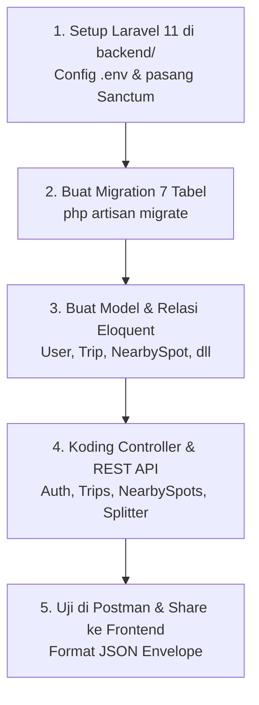

# 💻 Panduan Kerja Khusus: Backend Developer (Laravel 11)
> **Peran**: Backend API Engineer & Database Architect  
> **Target**: Membangun REST API Laravel 11, skema database MySQL 7 tabel, autentikasi Sanctum, dan endpoint offline-pack POI.

---

## 🎯 Tanggung Jawab Utama Anda
1. Setup proyek Laravel 11 di folder `backend/` dan sambungkan ke MySQL (`commute_mate_db`).
2. Membuat migration database untuk 7 tabel sesuai skema di [`docs/03_backend_api/ERD_DATABASE.md`](./docs/03_backend_api/ERD_DATABASE.md).
3. Membangun endpoint REST API sesuai kontrak di [`docs/03_backend_api/API_SPECIFICATION.md`](./docs/03_backend_api/API_SPECIFICATION.md).
4. Menguji seluruh endpoint di **Postman** dan membagikan URL-nya ke Frontend Developer.

---

## 📅 Alur Kerja Langkah demi Langkah (Step-by-Step)



### 1. Setup Awal Laravel 11:
1. Masuk ke folder `backend/`:
   ```bash
   cd backend
   composer install
   cp .env.example .env
   php artisan key:generate
   ```
2. Buat database baru di MySQL (XAMPP / Laragon):
   ```sql
   CREATE DATABASE commute_mate_db;
   ```
3. Sesuaikan koneksi di `.env`:
   ```ini
   DB_CONNECTION=mysql
   DB_HOST=127.0.0.1
   DB_PORT=3306
   DB_DATABASE=commute_mate_db
   DB_USERNAME=root
   DB_PASSWORD=
   ```
4. Pasang Laravel Sanctum:
   ```bash
   composer require laravel/sanctum
   php artisan vendor:publish --provider="Laravel\Sanctum\SanctumServiceProvider"
   ```

### 2. Membuat Migration 7 Tabel (Acuan: ERD_DATABASE.md):
Jalankan pembuatan migrasi untuk tabel:
- `users` (id, name, email, password, avatar_url)
- `trips` (id, user_id, title, origin_name, destination_name, status)
- `destination_stops` (id, trip_id, stop_name, latitude, longitude, alarm_radius_meters, is_alarm_triggered)
- `nearby_spots` (id, name, category, latitude, longitude, address, is_24_hours)
- `checklist_items` (id, user_id, trip_id, title, category, is_checked, is_exit_reminder)
- `expenses` (id, trip_id, title, amount, paid_by_name, split_rule, driver_name)
- `safety_contacts` (id, user_id, name, phone, is_primary)

Jalankan:
```bash
php artisan migrate
```

### 3. Membangun Endpoint REST API (Acuan: API_SPECIFICATION.md):
Pastikan format respon JSON selalu konsisten (*Envelope Format*):
```json
{
  "success": true,
  "message": "Operasi berhasil dilakukan.",
  "data": { ... }
}
```

Daftar endpoint wajib:
- **Autentikasi**:
  - `POST /api/auth/register` (Registrasi akun baru)
  - `POST /api/auth/login` (Login & dapatkan token Sanctum)
  - `GET /api/auth/me` (Data user login)
- **Perjalanan & Alarm**:
  - `GET /api/trips` (Daftar perjalanan)
  - `POST /api/trips` (Buat trip & titik alarm)
- **Nearby Spot**:
  - `GET /api/nearby-spots?lat=...&lng=...&category=...` (Cari tempat terdekat via Haversine)
  - `GET /api/nearby-spots/offline-pack` (Unduh dataset POI untuk mode offline)
- **Splitter & Uang Saku**:
  - `POST /api/trips/{id}/expenses` (Catat pengeluaran & toggle driver gratis)
  - `GET /api/trips/{id}/settlement` (Rincian bagi tagihan & pesan teks WhatsApp)

### 4. Pengujian di Postman:
- Sebelum diserahkan ke anak Frontend, pastikan semua endpoint sudah ditest di Postman dan mengembalikan status `200 OK` atau `201 Created`.

---

## 🛠️ Dokumen Rujukan Utama untuk Backend:
- [`docs/03_backend_api/ERD_DATABASE.md`](./docs/03_backend_api/ERD_DATABASE.md)
- [`docs/03_backend_api/API_SPECIFICATION.md`](./docs/03_backend_api/API_SPECIFICATION.md)
