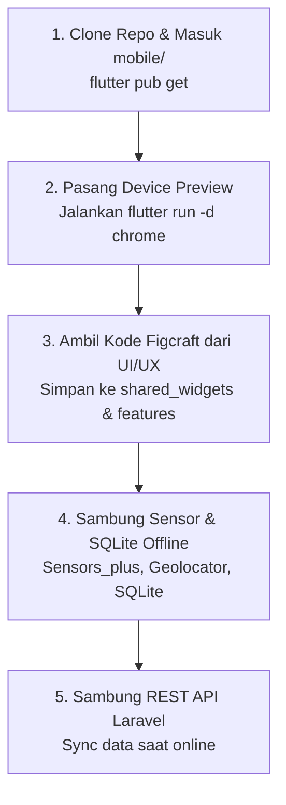

# 📱 Panduan Kerja Khusus: Frontend Mobile Developer (Flutter)
> **Peran**: Flutter Mobile Engineer  
> **Target**: Membangun aplikasi mobile Flutter yang responsif, offline-ready, terintegrasi sensor gerak & GPS, dan bisa di-preview di Chrome browser.

---

## 🎯 Tanggung Jawab Utama Anda
1. Setup proyek Flutter di folder `mobile/` dengan arsitektur *Feature-First*.
2. Memasang package `device_preview` agar aplikasi bisa dibuka di browser Chrome dengan bingkai HP iPhone/Android.
3. Mengambil kode Flutter hasil ekspor **Figcraft** dari UI/UX Designer, lalu menatanya di folder `shared_widgets/` dan `features/`.
4. Menyambungkan sensor gyroscope (`sensors_plus`) untuk KinetoGuard dan geolocator untuk alarm jarak 1.5 KM.
5. Menyambungkan database lokal **SQLite** (`sqflite`) agar aplikasi tetap berjalan lancar saat offline.

---

## 📅 Alur Kerja Langkah demi Langkah (Step-by-Step)



### 1. Persiapan Awal (Setup):
1. Clone repo: `git clone https://github.com/daifa-maulana/claude.ai.git`
2. Buka folder `mobile/` di VS Code.
3. Dependencies wajib di `pubspec.yaml`:
   ```yaml
   dependencies:
     flutter:
       sdk: flutter
     provider: ^6.1.2
     device_preview: ^1.2.0        # Pratinjau frame HP di browser Chrome
     sqflite: ^2.3.3+1             # Database lokal offline-first
     path_provider: ^2.1.4
     sensors_plus: ^5.0.1          # Baca gyro & accelerometer anti-mual
     geolocator: ^12.0.0           # Hitung jarak GPS alarm
     audioplayers: ^6.0.0          # Suara nada dering & 100 Hz soundscape
     flutter_map: ^7.0.0           # Peta OpenStreetMap (Gratis 100%)
     latlong2: ^0.9.1
     http: ^1.2.1
     shared_preferences: ^2.2.3
   ```
4. Jalankan `flutter pub get`.

### 2. Cara Mengaktifkan Device Preview (Frame HP di Browser):
Ikuti panduan di [`docs/04_frontend_mobile/FRONTEND_ARCHITECTURE.md`](./docs/04_frontend_mobile/FRONTEND_ARCHITECTURE.md):
- Bungkus `runApp` di `lib/main.dart` dengan `DevicePreview`.
- Jalankan di terminal:
  ```bash
  flutter run -d chrome
  ```
- Browser Chrome akan membuka aplikasi lengkap dengan frame fisik HP yang interaktif, bisa diganti jenis perangkatnya, dan bisa dirotasi!

### 3. Mengintegrasikan Kode Desain dari Figcraft:
- Ambil kode Flutter yang diekspor UI/UX Designer dari Figcraft.
- Simpan komponen kartu, tombol, dan chip di:
  📂 `mobile/lib/shared_widgets/`
- Simpan halaman layar per fitur di:
  📂 `mobile/lib/features/` (misal: `02_kinetoguard/`, `03_smart_wakeup/`, `04_travel_checklist/`).

### 4. Implementasi Fitur Khusus:
- **KinetoGuard (Anti-Mabuk)**:
  - Gunakan `accelerometerEvents.listen` dari `sensors_plus`.
  - Pasang *Low-Pass Filter* ($\alpha = 0.15$) agar pergerakan titik halus mengikuti gravitasi kendaraan.
- **Smart Wake-Up (Alarm 1.5 KM)**:
  - Hitung jarak koordinat saat ini ke destinasi menggunakan rumus *Haversine*.
  - Jika jarak $\le 1500$ meter $\to$ bunyikan alarm dan tampilkan pop-up checklist barang bawaan.
- **Peta Bebas Biaya (OpenStreetMap)**:
  - Gunakan widget `CommuteMateMapView` sesuai panduan di [`docs/04_frontend_mobile/MAPS_INTEGRATION_GUIDE.md`](./docs/04_frontend_mobile/MAPS_INTEGRATION_GUIDE.md).

---

## ⚠️ Aturan Kode Khusus Flutter:
- ❌ **Jangan pakai `Color.withValues()`** karena bisa error di Flutter 3.24.
- ✅ **Gunakan selalu `Color.withOpacity(...)`** (misal: `Colors.blue.withOpacity(0.12)`).
- 🧹 Jangan lupa panggil `cancel()` pada stream subscription sensor di method `dispose()` agar hemat baterai.
