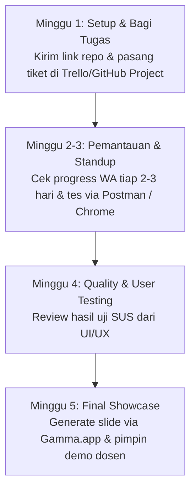

# 🧭 Panduan Kerja Khusus: Project Manager (PM)
> **Peran**: Ketua Tim, Product Owner, & Nakhoda Proyek  
> **Target**: Menjaga ritme kerja tim, menyelesaikan hambatan kodingan tim, dan memimpin presentasi akhir ke dosen (Nilai A).

---

## 🎯 Tanggung Jawab Utama Anda
1. **Tidak Perlu Koding Sendirian**: Tugas Anda adalah memastikan Backend, Frontend, dan UI/UX mengerjakan hal yang benar sesuai dokumen PRD.
2. **Timeline & Sprint**: Membagi tugas mingguan agar tidak menumpuk di malam sebelum pengumpulan tugas (*H-1 deadline*).
3. **Problem Solver**: Membantu memecahkan error anggota tim menggunakan panduan AI Prompting Playbook.
4. **Showcase**: Memimpin jalannya presentasi demo aplikasi di hadapan dosen penguji.

---

## 📅 Alur Kerja Anda dari Hari ke Hari (Step-by-Step)

### 1. Fase Sprint 1: Distribusi Tiket Tugas
- Buka papan [GitHub Projects](https://github.com/daifa-maulana/claude.ai/projects) atau Trello.
- Buat 3 kolom: `📋 To Do` $\to$ `⏳ In Progress` $\to$ `✅ Done`.
- Masukkan tugas dari [`TODO.md`](./TODO.md) untuk masing-masing orang.

### 2. Fase Sprint 2–3: Ritual Standup Santai (Tiap 2–3 Hari)
Kirim pesan singkat di grup WhatsApp tim:
> *"Halo guys! Biar tracking-nya rapi, update singkat yuk:*  
> *1. Kemarin udah beres bagian apa?*  
> *2. Hari ini rencananya ngerjain apa?*  
> *3. Ada kendala atau error kodingan yang bikin pusing?"*

### 3. Aksi Jika Ada Anggota Tim yang Mengalami Error:
- Buka file [`docs/01_project_management/AI_PROMPTING_PLAYBOOK.md`](./docs/01_project_management/AI_PROMPTING_PLAYBOOK.md).
- Gunakan template *"Debugging Formula"* untuk menanyakan solusi kodenya ke AI. Anda langsung jadi PM yang solutif!

### 4. Fase Pengujian (Minggu 4):
- Pantau UI/UX Tester saat menyebarkan kuesioner System Usability Scale (SUS).
- Pastikan skor rata-rata SUS di atas **75.0 (Grade B+)** sesuai acuan di [`docs/02_ui_ux_testing/USABILITY_TESTING_SUS.md`](./docs/02_ui_ux_testing/USABILITY_TESTING_SUS.md).

### 5. Fase Presentasi Kuliah (Minggu 5):
- Buka website **[Gamma.app](https://gamma.app)**.
- Salin teks dari [`PRD.md`](./PRD.md) ke Gamma.app untuk membuat slide presentasi otomatis dalam 1 menit.
- Pimpin skenario live demo di hadapan dosen:
  1. Tampilkan aplikasi di Chrome dengan frame HP (`device_preview`).
  2. Tunjukkan sensor KinetoGuard saat digerakkan.
  3. Simulasikan alarm Smart Wake-Up 1.5 KM dan dialog checklist barang keluar.
  4. Perlihatkan generate pesan WhatsApp untuk Fair Splitter.

---

## 🛠️ Tools Wajib untuk PM:
- **Task Board**: [GitHub Projects](https://github.com/daifa-maulana/claude.ai/projects) / [Trello](https://trello.com)
- **Cek API Backend**: [Postman](https://www.postman.com/) / extension VS Code *Thunder Client*
- **Slide Generator Kilat**: [Gamma.app](https://gamma.app) / Canva
- **Dokumen Referensi Utama**: [`PRD.md`](./PRD.md) & [`TODO.md`](./TODO.md)
