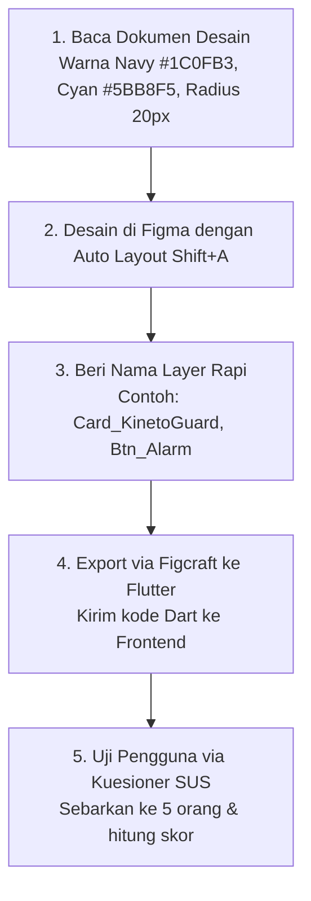

# 🎨 Panduan Kerja Khusus: UI/UX Designer & Tester
> **Peran**: Desainer Antarmuka, Pengembang Prototipe Figma, & Penguji Kepuasan Pengguna (SUS)  
> **Target**: Menghasilkan desain antarmuka yang bersih, mudah digunakan di kendaraan, dan menguji usability ke 5 responden.

---

## 🎯 Tanggung Jawab Utama Anda
1. Merancang tampilan antarmuka (UI) di **Figma** berdasarkan alur 7 fitur di [`docs/02_ui_ux_testing/USER_FLOWS_AND_WIREFRAMES.md`](./docs/02_ui_ux_testing/USER_FLOWS_AND_WIREFRAMES.md).
2. Memastikan seluruh komponen Figma menggunakan **Auto Layout (`Shift + A`)** dan nama layer rapi.
3. Mengonversi desain Figma ke kode Flutter menggunakan plugin **Figcraft** agar anak Frontend tidak koding dari nol.
4. Menyebarkan kuesioner **System Usability Scale (SUS)** ke 5 responden dan menghitung skor akhirnya.

---

## 📅 Alur Kerja Langkah demi Langkah (Step-by-Step)

### 1. Standar Desain Resmi (Design Tokens)
- **Primary Navy**: `#1C0FB3` (Warna utama header & tombol aksi)
- **Accent Motion Cyan**: `#5BB8F5` (Aksen tombol bulat FAB KinetoGuard)
- **Background Slate**: `#F4F6FB` (Latar belakang ramah mata saat kendaraan berguncang)
- **Soft Card Surface**: Putih `#FFFFFF` dengan shadow lembut `rgba(70, 80, 160, 0.08)` dan radius `20px`.

### 2. Aturan Wajib di Figma (Biar Frontend Gak Ngamuk)
- **Wajib Auto Layout (`Shift + A`)**:
  - Dilarang menaruh tombol/kartu secara bebas tanpa auto layout.
  - Arah **Horizontal** di Figma otomatis menjadi `Row` di Flutter.
  - Arah **Vertikal** di Figma otomatis menjadi `Column` di Flutter.
- **Wajib Nama Layer Rapi**:
  - `Screen_Dashboard` (Layar Dashboard)
  - `Card_KinetoGuard` (Kartu Anti-Mabuk)
  - `Card_WakeUp` (Kartu Alarm Bangun)
  - `Btn_StartTrip` (Tombol Mulai Perjalanan)

### 3. Cara Menggunakan Figcraft (Figma ➡️ Flutter):
1. Buka plugin **Figcraft** di Figma (klik kanan $\to$ Plugins $\to$ Figcraft).
2. Klik frame komponen atau layar yang ingin dikonversi.
3. Pilih bahasa **Flutter (Dart)** $\to$ klik **Generate Code**.
4. Salin kode Dart tersebut, lalu kirimkan ke Frontend Developer.

### 4. Pelaksanaan Pengujian Kegunaan (System Usability Scale / SUS):
- Buka dokumen panduan [`docs/02_ui_ux_testing/USABILITY_TESTING_SUS.md`](./docs/02_ui_ux_testing/USABILITY_TESTING_SUS.md).
- Buat Google Form dengan 10 pertanyaan baku skala Likert (1 = Sangat Tidak Setuju s/d 5 = Sangat Setuju).
- Minta 5 responden (teman sekelas/mahasiswa komuter) mencoba aplikasi CommuteMate.
- Hitung skor SUS menggunakan rumus:
  - Pertanyaan Ganjil (Q1, 3, 5, 7, 9): $\text{Skor} - 1$
  - Pertanyaan Genap (Q2, 4, 6, 8, 10): $5 - \text{Skor}$
  - Skor Akhir = $\text{Total Poin} \times 2.5$ (Target $\ge 75.0$ / Grade B+).

---

## 🛠️ Dokumen Rujukan Utama untuk UI/UX:
- [`docs/02_ui_ux_testing/USER_FLOWS_AND_WIREFRAMES.md`](./docs/02_ui_ux_testing/USER_FLOWS_AND_WIREFRAMES.md)
- [`docs/02_ui_ux_testing/FIGMA_TO_FLUTTER_FIGCRAFT_GUIDE.md`](./docs/02_ui_ux_testing/FIGMA_TO_FLUTTER_FIGCRAFT_GUIDE.md)
- [`docs/02_ui_ux_testing/USABILITY_TESTING_SUS.md`](./docs/02_ui_ux_testing/USABILITY_TESTING_SUS.md)
