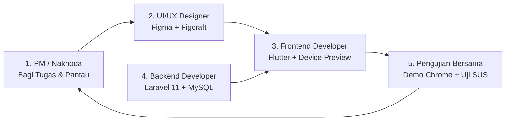

# 🚀 CommuteMate - Panduan Resmi Pengerjaan untuk Setiap Anggota Tim
> **Dokumen Utama Panduan Kerja Praktis (Master Team Workflow)**  
> *Wajib dibaca dan diikuti oleh seluruh anggota tim: Project Manager, UI/UX Designer, Frontend Developer, dan Backend Developer.*

---

## 👥 Matriks Tanggung Jawab & Alur Kolaborasi

---

## 🎨 1. Panduan Pengerjaan: UI/UX Designer & Tester

### Fokus Utama:
Merancang antarmuka yang bersih (*clean*), mudah digunakan penumpang saat di perjalanan, dan menguji tingkat kepuasan pengguna.

### Langkah-Langkah Kerja dari Hari ke Hari:
1. **Pahami Kebutuhan Layar & Warna**:
   - Buka dokumen [`docs/02_ui_ux_testing/USER_FLOWS_AND_WIREFRAMES.md`](./docs/02_ui_ux_testing/USER_FLOWS_AND_WIREFRAMES.md).
   - Gunakan palet warna resmi: Navy (`#1C0FB3`), Motion Cyan (`#5BB8F5`), dan Background Slate (`#F4F6FB`).
   - Gunakan sudut melengkung kartu (*Border Radius*): `20px`.
2. **Mulai Mendesain di Figma**:
   - Buat frame ukuran smartphone standar (*iPhone 14/15* atau *Android Large*).
   - **Aturan Wajib**: Setiap kali membuat tombol, baris input, atau kartu, **wajib menekan `Shift + A` (Auto Layout)**. Dilarang menaruh elemen secara melayang tanpa auto layout agar tidak berantakan saat dikoding.
   - Beri nama layer yang rapi dan bermakna (misal: `Card_KinetoGuard`, `Btn_Alarm`, `Input_Destination`).
3. **Konversi ke Kode Menggunakan Figcraft**:
   - Buka file [`docs/02_ui_ux_testing/FIGMA_TO_FLUTTER_FIGCRAFT_GUIDE.md`](./docs/02_ui_ux_testing/FIGMA_TO_FLUTTER_FIGCRAFT_GUIDE.md).
   - Klik kanan frame desain di Figma $\to$ pilih **Plugins** $\to$ **Figcraft** $\to$ pilih bahasa **Flutter (Dart)**.
   - Salin kode widget yang dihasilkan dan kirimkan ke Frontend Developer.
4. **Fase Pengujian Kegunaan (System Usability Scale / SUS)**:
   - Saat aplikasi sudah jalan, buka dokumen [`docs/02_ui_ux_testing/USABILITY_TESTING_SUS.md`](./docs/02_ui_ux_testing/USABILITY_TESTING_SUS.md).
   - Pindahkan 10 pertanyaan skala Likert ke Google Forms, lalu uji ke 5 responden dan hitung skor akhirnya untuk dimasukkan ke laporan akhir.

---

## 📱 2. Panduan Pengerjaan: Frontend Developer (Flutter)

### Fokus Utama:
Mengubah rancangan desain menjadi aplikasi mobile yang responsif, bekerja secara offline-first, dan memiliki tampilan pratinjau interaktif di browser.

### Langkah-Langkah Kerja dari Hari ke Hari:
1. **Setup Proyek Mobile**:
   - Clone repo ini: `git clone https://github.com/daifa-maulana/claude.ai.git`
   - Buka folder `mobile/` di VS Code.
   - Pastikan package utama sudah terpasang di `pubspec.yaml`:
     `provider`, `device_preview`, `sqflite`, `sensors_plus`, `geolocator`, `flutter_map`, `latlong2`.
2. **Aktifkan Pratinjau Bingkai HP di Browser (Device Preview)**:
   - Baca panduan di [`docs/04_frontend_mobile/FRONTEND_ARCHITECTURE.md`](./docs/04_frontend_mobile/FRONTEND_ARCHITECTURE.md).
   - Jalankan `flutter run -d chrome`.
   - Pastikan aplikasi terbuka di browser Chrome lengkap dengan bingkai fisik smartphone interaktif (seperti iPhone di referensi).
3. **Menerapkan Desain dari Figcraft**:
   - Ambil kode Flutter dari UI/UX Designer yang diekspor via Figcraft.
   - Taruh kartu-kartu yang reusable di folder `mobile/lib/shared_widgets/`.
   - Taruh layar utama per fitur di folder `mobile/lib/features/`.
4. **Menghubungkan Sensor & Logika**:
   - **KinetoGuard**: Sambungkan gyroscope via `sensors_plus` dengan peredam *low-pass filter* (alpha: 0.15).
   - **Smart Wake-Up**: Hitung jarak GPS ke koordinat tujuan via rumus *Haversine*. Begitu jarak $\le 1.5$ KM, bunyikan alarm dan munculkan dialog checklist barang bawaan.
   - **Nearby Spot**: Tampilkan peta OpenStreetMap (bebas biaya) via `flutter_map` sesuai dokumen [`docs/04_frontend_mobile/MAPS_INTEGRATION_GUIDE.md`](./docs/04_frontend_mobile/MAPS_INTEGRATION_GUIDE.md).
   - **Offline-First**: Simpan data checklist dan riwayat trip ke SQLite lokal di HP.

---

## 💻 3. Panduan Pengerjaan: Backend Developer (Laravel 11)

### Fokus Utama:
Membangun REST API yang cepat, aman, dan menyediakan dataset titik singgah darurat untuk diunduh oleh aplikasi mobile.

### Langkah-Langkah Kerja dari Hari ke Hari:
1. **Setup Laravel & Database**:
   - Clone repo ini dan masuk ke folder `backend/`.
   - Siapkan database MySQL (lewat XAMPP / Laragon) dengan nama `commute_mate_db`.
   - Konfigurasi file `.env` dan jalankan `php artisan key:generate`.
   - Pasang Laravel Sanctum untuk sistem autentikasi Bearer Token.
2. **Membuat Struktur Database dari ERD**:
   - Buka dokumen [`docs/03_backend_api/ERD_DATABASE.md`](./docs/03_backend_api/ERD_DATABASE.md).
   - Buat migration untuk 7 tabel utama:
     `users`, `trips`, `destination_stops`, `nearby_spots`, `checklist_items`, `expenses`, `safety_contacts`.
   - Jalankan `php artisan migrate`.
3. **Membangun Endpoint REST API**:
   - Buka dokumen [`docs/03_backend_api/API_SPECIFICATION.md`](./docs/03_backend_api/API_SPECIFICATION.md).
   - Buat controller untuk:
     - Auth: `/api/auth/register`, `/api/auth/login`, `/api/auth/me`.
     - Trips: `/api/trips` (riwayat dan alarm tujuan).
     - Nearby Spots: `/api/nearby-spots` dan `/api/nearby-spots/offline-pack`.
     - Checklist: `/api/checklists/sync`.
     - Splitter: `/api/trips/{id}/expenses` dan `/api/trips/{id}/settlement`.
4. **Pengujian di Postman**:
   - Uji setiap endpoint menggunakan Postman atau Thunder Client di VS Code.
   - Pastikan respon JSON selalu dalam format standar: `{ "success": true, "message": "...", "data": [...] }`.
   - Setelah sukses, bagikan endpoint URL ke Frontend Developer.

---

## 🧭 4. Panduan Pengerjaan: Project Manager (Anda)

### Fokus Utama:
Menjaga ritme kerja tim, memastikan lingkup proyek tidak keluar jalur, menyelesaikan hambatan kodingan tim, dan memimpin presentasi akhir di hadapan dosen.

### Langkah-Langkah Kerja dari Hari ke Hari:
1. **Distribusi Tugas & Papan Pantau**:
   - Buka GitHub Projects di repositori tim atau buat papan di Trello.
   - Masukkan daftar tugas minggu ini dari dokumen [`TODO.md`](./TODO.md).
2. **Ritual Standup Santai (Tiap 2–3 Hari di WhatsApp)**:
   - Tanyakan 3 hal sederhana ke grup tim:
     1. *"Apa yang sudah berhasil kamu selesaikan?"*
     2. *"Apa yang sedang dikerjakan hari ini?"*
     3. *"Ada error atau kendala teknis yang bikin pusing?"*
3. **Bantu Pecahkan Error Anggota Tim lewat AI**:
   - Jika ada rekan tim yang mentok kodingannya, buka dokumen [`docs/01_project_management/AI_PROMPTING_PLAYBOOK.md`](./docs/01_project_management/AI_PROMPTING_PLAYBOOK.md).
   - Gunakan template prompt sakti di playbook tersebut untuk menanyakan solusi perbaikan kodenya ke AI.
4. **Simulasi Demo & Persiapan Sidang Kuliah**:
   - Baca panduan kepemimpinan di [`docs/01_project_management/PM_HANDBOOK_AND_TOOLS.md`](./docs/01_project_management/PM_HANDBOOK_AND_TOOLS.md).
   - Gunakan **Gamma.app** untuk membuat slide presentasi estetik dalam 1 menit menggunakan teks dari [`PRD.md`](./PRD.md).
   - Pimpin jalannya presentasi demo aplikasi di hadapan dosen penguji agar tim meraih nilai maksimal (A).

---

## 🔒 5. Aturan Emas Kolaborasi Tim
1. **No Panic Coding**: Jika ada error merah di terminal, jangan panik dan jangan hapus kode sembarangan. Gunakan formula debugging di AI Prompting Playbook.
2. **Pull Sebelum Push**: Sebelum mengunggah kode baru ke GitHub, selalu lakukan `git pull origin main` untuk menghindari konflik kode dengan rekan tim.
3. **Offline-First Commitment**: Seluruh fitur utama (anti-mabuk, alarm GPS, checklist) wajib tetap berfungsi meskipun HP dalam mode pesawat atau di daerah tanpa sinyal.
