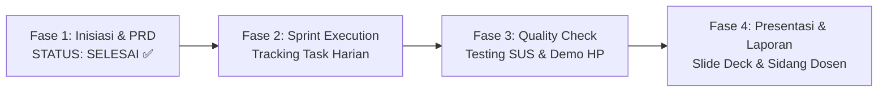

# 🧭 CommuteMate - PM Handbook & Recommended Tools
**Buku Saku Panduan Project Manager & Product Owner (PM)**  
*Pedoman Kepemimpinan Proyek dari Fase Sprint hingga Sidang Presentasi Akhir*

---

## 1. Peran Hakiki Anda sebagai PM (The Captain of the Ship)

Sebagai **Project Manager (PM)**, Anda adalah **nakhoda proyek**. Tugas Anda **bukan** mengetik semua baris kode (*coding*) sendirian, melainkan:
1. **Direction (Arah)**: Memastikan Backend, Frontend, dan UI/UX mengerjakan hal yang benar sesuai [`PRD.md`](../../PRD.md).
2. **Velocity (Kecepatan)**: Menjaga ritme kerja tim agar tidak menumpuk di malam sebelum pengumpulan tugas (*H-1 deadline*).
3. **Bridge (Jembatan)**: Menengahi diskusi teknis antara Frontend dan Backend jika ada perbedaan format data API.
4. **Showcase (Etalase)**: Memimpin presentasi demo aplikasi di hadapan dosen penguji agar mendapatkan nilai maksimal (A).

---

## 2. Siklus Kerja PM dari Hari ke Hari (Step-by-Step)

### A. Fase Saat Ini: Sprint Execution (Minggu 1 - 3)
- **Tugas Utama**: Membagi tiket tugas ke masing-masing anggota.
- **Ritual 10-Menit (Daily Standup di WhatsApp/Discord)**:
  Tiap 2 atau 3 hari sekali, tanyakan 3 pertanyaan sederhana ini ke tim:
  1. *"Kemarin progres kamu udah sampai mana?"*
  2. *"Hari ini rencananya mau nyelesaiin fitur apa?"*
  3. *"Ada error atau kendala yang bikin kamu mentok?"*
- **Aksi PM Jika Ada Anggota Mentok**:
  Gunakan template di [`AI_PROMPTING_PLAYBOOK.md`](./AI_PROMPTING_PLAYBOOK.md) untuk membantu rekan Anda menyelesaikan error tersebut lewat AI.

### B. Fase Pengujian (Minggu 4)
- Pastikan UI/UX Designer menjalankan **SUS Testing** ke 5 teman sekelas menggunakan instrumen di [`USABILITY_TESTING_SUS.md`](../02_ui_ux_testing/USABILITY_TESTING_SUS.md).
- Pastikan skor SUS di atas **75.0 (Grade B+)**. Nilai ini menjadi bukti riset ilmiah yang sangat disukai dosen.

### C. Fase Presentasi & Demo (Minggu 5)
- Siapkan skenario **Live Demo**:
  1. Tampilkan aplikasi di layar proyektor laptop via browser Chrome dengan frame iPhone (`device_preview`).
  2. Demonstrasikan sensor miring KinetoGuard.
  3. Simulasikan alarm Smart Wake-Up 1.5 KM dan munculnya checklist "Don't Leave Me".
  4. Perlihatkan generate pesan WhatsApp untuk Fair Splitter.

---

## 3. Rekomendasi Tools Wajib untuk PM

Berikut adalah kumpulan tools gratis yang membuat kerja Anda sebagai PM terlihat sangat profesional:

| Kategori Kebutuhan | Nama Tool Rekomendasi | Mengapa Sangat Bagus & Cara Pakainya? |
|---|---|---|
| **Task Management (Kanban Board)** | **GitHub Projects** *(Bawaan Repo)* atau **Trello** | Buat 3 kolom sederhana: `To Do` $\to$ `In Progress` $\to$ `Done`. Masukkan tugas dari [`TODO_LIST.md`](./TODO_LIST.md). |
| **API Testing (Pemeriksa Backend)** | **Postman** atau **Thunder Client (VS Code)** | Digunakan untuk menguji apakah backend Laravel buatan rekan Anda sudah bisa merespon data JSON tanpa harus nunggu aplikasi Flutter selesai. |
| **Pratinjau Mobile (Demo)** | **Chrome Browser + `device_preview`** | Menampilkan frame smartphone interaktif di laptop tanpa perlu emulator Android Studio yang berat. |
| **Desain & Wireframe** | **Figma** | Tempat UI/UX Designer meletakkan rancangan antarmuka Soft UI sebelum dikoding ke Flutter. |
| **Slide Presentasi Kilat (AI)** | **Gamma.app** atau **Canva** | Masukkan teks dari `PRD.md` ke Gamma.app, dalam 1 menit slide presentasi estetik dengan visual modern langsung jadi otomatis! |
| **Catatan & Dokumen Tim** | **Notion** atau **Google Docs** | Tempat menampung notula rapat dan draft laporan akhir kuliah. |

---

## 4. Checklist Kesiapan Anda Minggu Ini

- [x] Repositori GitHub dibuat dan terhubung: `daifa-maulana/claude.ai`
- [x] PRD & Spesifikasi Teknis selesai dan terdokumentasi
- [x] Kontrak API & Skema ERD selesai
- [x] Panduan Prompting AI dibagikan ke tim
- [ ] Buat 1 papan Trello / GitHub Project dan masukkan task Sprint 1
- [ ] Bagikan link repositori GitHub ke 3 rekan tim Anda
- [ ] Jalankan scaffold kode awal `mobile` (Flutter) dan `backend` (Laravel)

