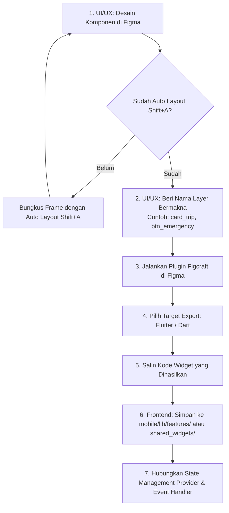

# 🎨 CommuteMate - Figma to Flutter (Figcraft) Integration Guide
**Standard Operating Procedure (SOP) Konversi Desain UI/UX ke Kode Flutter 100% Akurat**  
*Versi: 1.0.0 | Tool Utama: Figcraft Plugin + Figma Auto-Layout + Flutter 3.24+*

---

## 1. Latar Belakang & Masalah yang Diselesaikan

Dalam pengembangan aplikasi mobile, masalah klasik yang sering terjadi adalah **"Design-to-Code Discrepancy"** (tampilan di kodingan Flutter berbeda jauh dengan rancangan di Figma, jarak margin berantakan, atau terjadi *pixel overflow*).

Untuk menjamin hasil implementasi **identik 100% (1:1 Pixel Accurate)** tanpa membebani developer mengetik ulang dari nol, tim CommuteMate menetapkan standar resmi menggunakan plugin **Figcraft**.

---

## 2. Alur Kerja Resmi (End-to-End Workflow)

---

## 3. Standar Wajib untuk UI/UX Designer di Figma

Agar kode yang diekstrak oleh Figcraft langsung rapi dan bersih:

### A. Wajib Auto Layout (`Shift + A`)
- Dilarang keras menaruh elemen secara melayang bebas (*floating absolute*) tanpa pembungkus.
- Setiap tombol, baris input, dan kartu **wajib dibungkus Auto Layout**:
  - Arah **Horizontal** di Figma otomatis menjadi widget `Row()` di Flutter.
  - Arah **Vertikal** di Figma otomatis menjadi widget `Column()` di Flutter.
  - Gap antar item di Figma otomatis menjadi `SizedBox(width: ...)` atau `SizedBox(height: ...)`.

### B. Konvensi Penamaan Layer (*Naming Convention*)
Figcraft akan menggunakan nama layer di Figma sebagai nama variabel dan nama class widget di Flutter. Gunakan aturan penamaan berikut:

| Jenis Elemen | Format Nama di Figma | Hasil Widget di Flutter |
|---|---|---|
| Layar Penuh | `Screen_Dashboard` | `class ScreenDashboard extends StatelessWidget` |
| Kartu Fitur | `Card_KinetoGuard` | `class CardKinetoGuard extends StatelessWidget` |
| Tombol Aksi | `Btn_StartTrip` | `ElevatedButton / GestureDetector` |
| Kolom Input | `Input_Destination` | `TextField / TextFormField` |
| Label Teks | `Txt_TitleGreeting` | `Text('...', style: ...)` |

### C. Konsistensi Token Desain
Gunakan warna dan radius sudut yang sudah disepakati di [`USER_FLOWS_AND_WIREFRAMES.md`](./USER_FLOWS_AND_WIREFRAMES.md):
- Primary Navy: `#1C0FB3`
- Accent Cyan: `#5BB8F5`
- Background Slate: `#F4F6FB`
- Card Radius: `20px`

---

## 4. Panduan Eksekusi untuk Frontend Developer (Flutter)

### A. Cara Menjalankan Figcraft di Figma:
1. Buka file project Figma CommuteMate.
2. Klik kanan pada frame komponen/layar yang ingin dikoding $\to$ pilih **Plugins** $\to$ ketik **Figcraft** $\to$ klik **Run**.
3. Pada jendela Figcraft:
   - Pilih tab bahasa: **Flutter (Dart)**.
   - Klik **Generate Code**.
4. Salin kode yang dihasilkan.

### B. Meletakkan Kode di Arsitektur Flutter:
- Komponen kecil yang dipakai berulang (misal: tombol, kartu soft UI, badge chip) disimpan di:
  📂 `mobile/lib/shared_widgets/`
- Layar utuh (misal: dashboard screen, wakeup screen) disimpan di modul fiturnya masing-masing di:
  📂 `mobile/lib/features/`

### C. Menghubungkan Interaktivitas & Logika:
Kode hasil generate Figcraft adalah tampilan antarmuka murni (*Pure UI Presentation*). Tugas anak Frontend adalah:
1. Mengubah widget menjadi `Consumer<TripProvider>` atau `StatefulWidget` jika membutuhkan data dinamis.
2. Menghubungkan `onTap` pada tombol dengan fungsi controller (misal: menyalakan GPS geofence atau membuka kamera).
3. Mengganti teks statis dengan variabel dari model/database lokal SQLite.

---

## 5. Ringkasan Tugas Saling Kontrol (Checklist Kolaborasi)

- [ ] **UI/UX**: Memastikan seluruh frame di Figma sudah `Shift + A` (Auto Layout).
- [ ] **UI/UX**: Memastikan nama layer rapi sebelum diserahkan ke Frontend.
- [ ] **Frontend**: Meng-export komponen menggunakan Figcraft dan menaruhnya di struktur folder yang sesuai.
- [ ] **PM**: Mengecek kesesuaian visual hasil run di Chrome (`device_preview`) dengan Figma aslinya.
