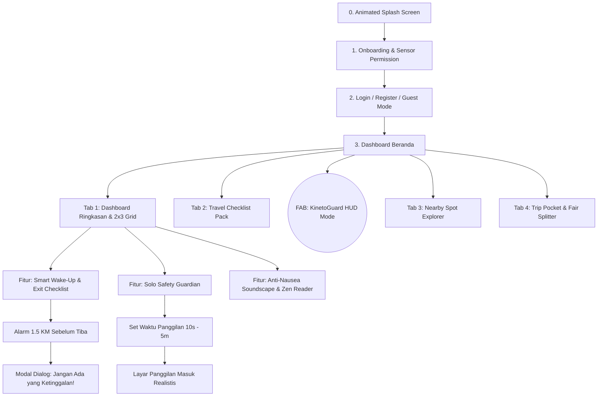
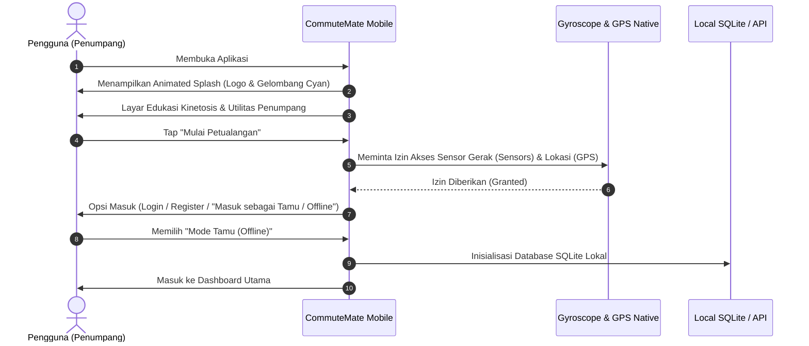
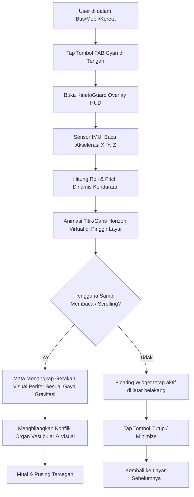
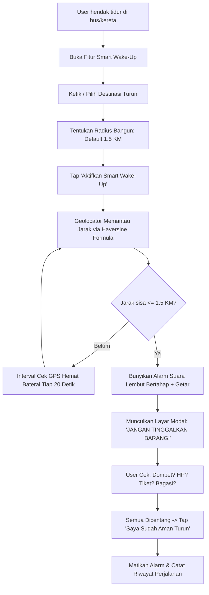
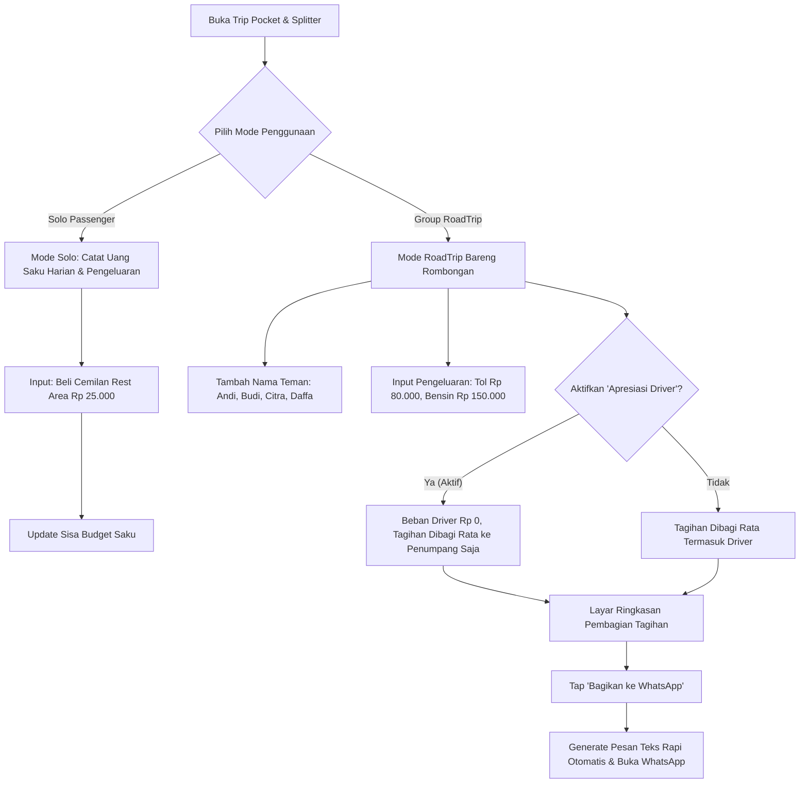

# 📱 CommuteMate - User Flows & Wireframe Specifications
**Dokumen Panduan UI/UX Designer & User Testing**  
*Versi: 1.0.0 | Status: Official Engineering Specs*

---

## 1. Arsitektur Informasi & Peta Navigasi (Navigation Map)

Aplikasi CommuteMate dirancang dengan pola navigasi **Single-Screen Focused + Floating Curved Wave Bar** dengan Tombol Aksi Utama (FAB) di tengah.



---

## 2. End-to-End User Flows (7 Fitur Utama)

### Flow 1: Onboarding, Sensor Permission & Mode Akses


---

### Flow 2: KinetoGuard (HUD Anti-Mabuk Perjalanan)
Fitur inti pencegah mabuk kendaraan menggunakan peripheral visual cue berbasis teori *Sensory Conflict*.



---

### Flow 3: Smart Wake-Up & "Don't Leave Me" Exit Checklist
Alarm jarak berbasis geofence yang membangunkan penumpang 1.5 km sebelum tujuan dan memunculkan pop-up checklist barang bawaan.



---

### Flow 4: Pre-Trip Travel Checklist
```mermaid
flowchart LR
    OpenPack[Buka Menu Checklist] --> ViewDefault[Lihat Barang Bawaan Standar: Dompet, HP, Charger, Tiket, KTP]
    ViewDefault --> AddItem[Tap '+ Tambah Barang Kustom']
    AddItem --> InputTitle[Ketik Nama Barang & Kategori]
    InputTitle --> SaveLocal[Simpan ke SQLite Lokal]
    SaveLocal --> TogglePack[Tap Checkbox saat Memasukkan ke Tas]
    TogglePack --> ProgressCalc[Update Progress Bar: 4/5 (80% Siap)]
```

---

### Flow 5: Nearby Spot Passenger Explorer (Tempat Darurat Terdekat)
```mermaid
flowchart TD
    OpenNearby[Buka Menu Nearby Spot] --> DetectLoc[Ambil Koordinat Terkini GPS]
    DetectLoc --> SelectCat{Pilih Kategori Kebutuhan}
    SelectCat --> Cat1[Toilet Umum]
    SelectCat --> Cat2[Rest Area]
    SelectCat --> Cat3[SPBU / Pertamina]
    SelectCat --> Cat4[Tempat Makan / Kuliner Singgah]
    SelectCat --> Cat5[Minimarket / ATM Darurat]
    
    Cat1 & Cat2 & Cat3 & Cat4 & Cat5 --> QueryLocal[Filter dari Dataset SQLite Lokal - Mode Offline]
    QueryLocal --> SortDistance[Urutkan Berdasarkan Jarak Terdekat (Meter/KM)]
    SortDistance --> RenderCards[Tampilkan List Card: Jarak, Fasilitas, Estimasi Jalan/Berkendara]
    RenderCards --> TapCard[Tap Card Pilihan]
    TapCard --> ShowRoute[Tampilkan Arah & Pin Peta Sederhana]
```

---

### Flow 6: Trip Pocket & Fair Splitter (Bagi Tagihan & Uang Saku)


---

### Flow 7: Solo Safety Guardian (Panggilan Darurat Palsu)

```mermaid
flowchart LR
    DangerFeel[Penumpang merasa tidak aman / curiga di taksi] --> QuickTap[Buka Solo Safety Guardian]
    QuickTap --> SelectDelay[Pilih Jeda Waktu: 10 Detik / 30 Detik / Sekarang]
    SelectDelay --> SelectCaller[Pilih Identitas Penelepon: 'Ayah' / 'Kakak' / 'Polisi']
    SelectCaller --> WaitDelay[Layar Tetap Tenang / Terkunci]
    WaitDelay --> TriggerCall[Layar Menampilkan Panggilan Telepon Masuk Persis Asli]
    TriggerCall --> PlayRingtone[Suara Nada Dering Standar Ponsel Berbunyi]
    PlayRingtone --> AcceptCall[User Geser Jawab: 'Halo Ayah, ini aku udah di deket jembatan...']
```


---

## 3. Spesifikasi Wireframe & Komponen Visual

### A. Palet Warna (Design Tokens)
- **Primary Navy / Royal Blue**: `#1C0FB3` (Elegan, kredibel, memberikan rasa aman)
- **Accent Motion Cyan**: `#5BB8F5` (Dinamis, aksen futuristik, visual guide)
- **Light Slate Background**: `#F4F6FB` (Bersih, ramah mata saat kendaraan berguncang)
- **Soft Card Surface**: `#FFFFFF` dengan shadow `rgba(70, 80, 160, 0.08)` dan radius `20px`
- **Warning / Emergency Amber**: `#FF9F43` (Untuk status alarm dan pengingat)
- **Success Safe Mint**: `#10B981` (Untuk checklist selesai dan radius aman)

### B. Anatomi Komponen Antarmuka (UI Anatomy)
1. **Header Penumpang**:
   - Status Perjalanan Aktif (misal: *"Menuju: Terminal Leuwipanjang - 4.2 KM tersisa"*).
   - Chip Indikator Status Sensor (GPS Aktif, KinetoGuard Siap).
2. **Dashboard 2x3 Grid (Soft Touch Cards)**:
   - Kartu 1: *KinetoGuard HUD* (Icon Wave Gyro, Aksen Biru Muda).
   - Kartu 2: *Smart Wake-Up* (Icon Lonceng Geofence, Badge Jarak).
   - Kartu 3: *Travel Checklist* (Icon Koper & Check, Progress Bar `4/5`).
   - Kartu 4: *Nearby Spot Explorer* (Icon Peta & Pin, Kategori Cepat).
   - Kartu 5: *Fair Splitter & Pocket* (Icon Dompet & Bagi Tagihan).
   - Kartu 6: *Solo Safety Guardian* (Icon Perisai & Telepon Cepat).
3. **Curved Wave Bottom Navigation Bar**:
   - 4 Tab Menu: Beranda (Home), Checklist (Packing), Tempat (Nearby), Dompet (Splitter).
   - Floating Action Button (FAB) di tengah dengan warna Cyan `#5BB8F5` untuk aktivasi instan KinetoGuard.

