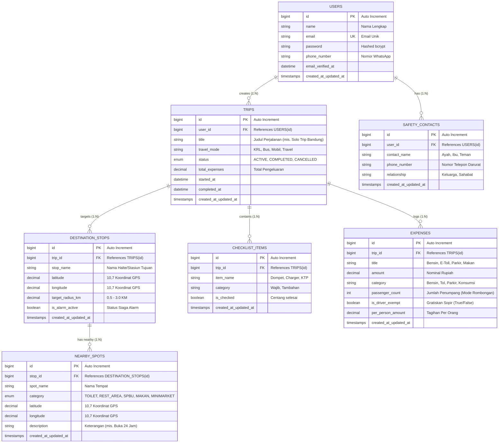

# 🗄️ DOKUMENTASI ERD & SPESIFIKASI DATABASE
## Backend Architecture: Laravel 11 + MySQL (REST API)
> **Role Target**: Backend Developer  
> **Project**: CommuteMate  
> **Status**: Ready for Migration & Implementation

---

## 1. Visual Entity Relationship Diagram (ERD)



---

## 2. Kamus Data (Data Dictionary)

### 2.1 Tabel `users`
| Kolom | Tipe Data | Nullable | Keterangan |
|---|---|---|---|
| `id` | `BIGINT UNSIGNED` | No | Primary Key (Auto Increment) |
| `name` | `VARCHAR(255)` | No | Nama lengkap pengguna |
| `email` | `VARCHAR(255)` | No | Email akun (Unique) |
| `password` | `VARCHAR(255)` | No | Hash password (Laravel bcrypt) |
| `phone_number`| `VARCHAR(20)` | Yes | Nomor telepon / WhatsApp |
| `created_at` | `TIMESTAMP` | Yes | Waktu pendaftaran |

### 2.2 Tabel `trips`
| Kolom | Tipe Data | Nullable | Keterangan |
|---|---|---|---|
| `id` | `BIGINT UNSIGNED` | No | Primary Key |
| `user_id` | `BIGINT UNSIGNED` | No | Relasi ke `users.id` (Foreign Key, Cascade) |
| `title` | `VARCHAR(255)` | No | Judul perjalanan (mis. Solo Trip Jogja) |
| `travel_mode` | `VARCHAR(50)` | No | Moda (KRL, Bus, Mobil, Travel) |
| `status` | `ENUM` | No | Nilai: `'ACTIVE'`, `'COMPLETED'`, `'CANCELLED'` |
| `total_expenses` | `DECIMAL(12,2)`| No | Default 0.00 |

### 2.3 Tabel `destination_stops` (Halte / Stasiun Alarm GPS)
| Kolom | Tipe Data | Nullable | Keterangan |
|---|---|---|---|
| `id` | `BIGINT UNSIGNED` | No | Primary Key |
| `trip_id` | `BIGINT UNSIGNED` | No | Relasi ke `trips.id` |
| `stop_name` | `VARCHAR(255)` | No | Nama stasiun / halte tujuan |
| `latitude` | `DECIMAL(10,7)` | No | Koordinat Lintang GPS |
| `longitude`| `DECIMAL(10,7)` | No | Koordinat Bujur GPS |
| `target_radius_km`| `DECIMAL(4,2)`| No | Radius pemicu alarm bangun (default 1.50) |
| `is_alarm_active` | `BOOLEAN` | No | Status aktif alarm |

### 2.4 Tabel `nearby_spots` (Pencari Titik Darurat Penumpang)
| Kolom | Tipe Data | Nullable | Keterangan |
|---|---|---|---|
| `id` | `BIGINT UNSIGNED` | No | Primary Key |
| `stop_id` | `BIGINT UNSIGNED` | Yes| Relasi ke halte terdekat (opsional) |
| `spot_name` | `VARCHAR(255)` | No | Nama titik (mis. Toilet Umum Stasiun) |
| `category` | `ENUM` | No | `'TOILET'`, `'REST_AREA'`, `'SPBU'`, `'MAKAN'`, `'MINIMARKET'` |
| `latitude` | `DECIMAL(10,7)` | No | Koordinat Lintang |
| `longitude`| `DECIMAL(10,7)` | No | Koordinat Bujur |
| `description`| `TEXT` | Yes| Catatan (mis. Buka 24 Jam, Bersih) |

### 2.5 Tabel `checklist_items` (Persiapan & Don't Leave Me)
| Kolom | Tipe Data | Nullable | Keterangan |
|---|---|---|---|
| `id` | `BIGINT UNSIGNED` | No | Primary Key |
| `trip_id` | `BIGINT UNSIGNED` | No | Relasi ke `trips.id` |
| `item_name` | `VARCHAR(255)` | No | Nama barang (Dompet, Charger, Jaket) |
| `category` | `VARCHAR(50)` | No | `'Wajib'`, `'Tambahan'` |
| `is_checked`| `BOOLEAN` | No | Default `false` |

### 2.6 Tabel `expenses` (Uang Saku & Patungan)
| Kolom | Tipe Data | Nullable | Keterangan |
|---|---|---|---|
| `id` | `BIGINT UNSIGNED` | No | Primary Key |
| `trip_id` | `BIGINT UNSIGNED` | No | Relasi ke `trips.id` |
| `title` | `VARCHAR(255)` | No | Nama pos (Bensin Pertamax, Tol Pasteur) |
| `amount` | `DECIMAL(12,2)` | No | Nominal rupiah |
| `category` | `VARCHAR(50)` | No | Bensin, Tol, Parkir, Konsumsi |
| `passenger_count` | `INT` | No | Default 1 (Mode Solo) atau > 1 |
| `is_driver_exempt` | `BOOLEAN`| No | Default `true` (Apresiasi Sopir) |
| `per_person_amount`| `DECIMAL(12,2)`| No | Hasil kalkulasi per orang |

---

## 3. Relasi Model Eloquent (Laravel)

```php
// app/Models/User.php
class User extends Authenticatable {
    public function trips() {
        return $this->hasMany(Trip::class);
    }
    public function safetyContacts() {
        return $this->hasMany(SafetyContact::class);
    }
}

// app/Models/Trip.php
class Trip extends Model {
    public function user() {
        return $this->belongsTo(User::class);
    }
    public function destinationStops() {
        return $this->hasMany(DestinationStop::class);
    }
    public function checklistItems() {
        return $this->hasMany(ChecklistItem::class);
    }
    public function expenses() {
        return $this->hasMany(Expense::class);
    }
}
```

---

## 4. Daftar REST API Endpoints untuk Frontend

| Method | Endpoint | Fungsi | Auth |
|---|---|---|:---:|
| `POST` | `/api/auth/register` | Mendaftarkan akun baru | No |
| `POST` | `/api/auth/login` | Login & dapatkan Bearer Token | No |
| `GET` | `/api/trips` | Ambil riwayat perjalanan user | Yes |
| `POST` | `/api/trips` | Buat trip perjalanan baru | Yes |
| `GET` | `/api/nearby-spots` | Ambil data toilet, SPBU, rest area (dengan filter kategori) | No |
| `POST` | `/api/trips/{id}/sync` | Sinkronisasi data offline dari mobile ke server | Yes |

