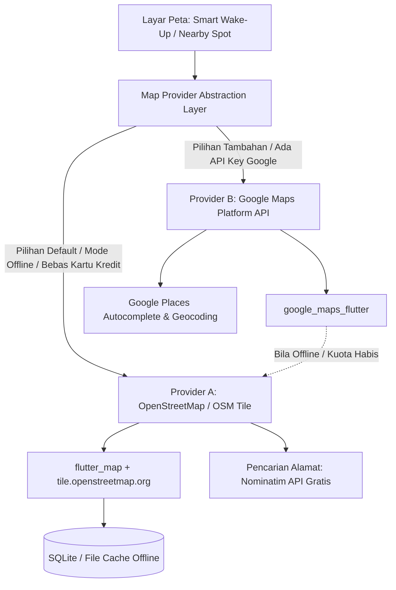
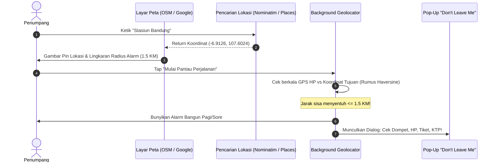

# 🗺️ CommuteMate - Hybrid Maps Integration Guide
**Panduan Arsitektur Dual-Engine Map: OpenStreetMap (OSM) & Google Maps API**  
*Versi: 1.1.0 | Status: Architecture Decision Record (ADR-004)*

---

## 1. Filosofi Dual-Engine (Hybrid Map Provider)

Aplikasi CommuteMate dirancang dengan pola arsitektur **Pluggable Map Engine (Dual-Provider)**. Pengguna atau tim pengembang dapat dengan mudah memilih/beralih antara dua provider peta:



### Perbandingan Kedua Provider:

| Kriteria Evaluasi | Provider A: OpenStreetMap (OSM) | Provider B: Google Maps API |
|---|---|---|
| **Status Lisensi** | 100% Gratis & Open Source | Berbayar (Gratis \$200 kredit/bulan, butuh CC) |
| **Kebutuhan API Key** | **Tidak Butuh API Key** (Langsung jalan) | **Wajib API Key** (Google Cloud Console) |
| **Kinerja Offline** | **Sangat Baik** (Tile peta bisa di-download lokal) | Terbatas (Hanya cache bawaan SDK) |
| **Pencarian Alamat** | OSM Nominatim API (Gratis) | Google Places API (Sangat akurat & lengkap) |
| **Kesesuaian Tim** | Default tim mahasiswa & pengujian umum | Opsi integrasi lanjutan bagi tim backend |

---

## 2. Struktur Kode & Abstraksi Dual-Provider di Flutter

Agar kode aplikasi rapi dan tidak bercampur aduk, Frontend Developer menggunakan pola **Abstract Factory Pattern**:

```text
mobile/lib/core/maps/
├── map_provider_interface.dart      # Interface seragam untuk controller peta
├── providers/
│   ├── osm_map_provider.dart        # Implementasi flutter_map (OpenStreetMap)
│   └── google_map_provider.dart     # Implementasi google_maps_flutter
├── map_view_wrapper.dart            # Widget serbaguna yang otomatis memilih engine
└── search/
    ├── osm_nominatim_search.dart    # Geocoder gratis OpenStreetMap
    └── google_places_search.dart    # Geocoder Google Places API
```

### A. Interface Kontrak Peta (`map_provider_interface.dart`)
```dart
import 'package:flutter/material.dart';

enum MapEngineType { openStreetMap, googleMaps }

class GeoPoint {
  final double latitude;
  final double longitude;
  final String? title;

  const GeoPoint({required this.latitude, required this.longitude, this.title});
}

abstract class IMapController {
  void moveToLocation(GeoPoint point, {double zoomLevel = 15.0});
  void addMarker(GeoPoint point, {String? markerId, Widget? customIcon});
  void clearMarkers();
  void drawGeofenceCircle(GeoPoint center, double radiusMeters);
}
```

### B. Widget Pembungkus Fleksibel (`map_view_wrapper.dart`)
```dart
import 'package:flutter/material.dart';
import 'package:provider/provider.dart';
import 'package:flutter_map/flutter_map.dart' as osm;
import 'package:latlong2/latlong.dart' as latlong;
import 'package:google_maps_flutter/google_maps_flutter.dart' as gmaps;

class CommuteMateMapView extends StatelessWidget {
  final double initialLat;
  final double initialLng;
  final double alarmRadiusMeters;
  final MapEngineType engine;
  final Function(double lat, double lng)? onLocationSelected;

  const CommuteMateMapView({
    super.key,
    required this.initialLat,
    required this.initialLng,
    this.alarmRadiusMeters = 1500,
    this.engine = MapEngineType.openStreetMap, // Default OSM
    this.onLocationSelected,
  });

  @override
  Widget build(BuildContext context) {
    if (engine == MapEngineType.googleMaps) {
      // Opsi 1: Google Maps Native SDK
      return gmaps.GoogleMap(
        initialCameraPosition: gmaps.CameraPosition(
          target: gmaps.LatLng(initialLat, initialLng),
          zoom: 14.0,
        ),
        circles: {
          gmaps.Circle(
            circleId: const gmaps.CircleId('alarm_buffer'),
            center: gmaps.LatLng(initialLat, initialLng),
            radius: alarmRadiusMeters,
            fillColor: const Color(0x335BB8F5),
            strokeColor: const Color(0xFF1C0FB3),
            strokeWidth: 2,
          ),
        },
        onTap: (latLng) {
          if (onLocationSelected != null) {
            onLocationSelected!(latLng.latitude, latLng.longitude);
          }
        },
      );
    }

    // Opsi 2 (Default): OpenStreetMap via flutter_map (100% Gratis & Offline Ready)
    return osm.FlutterMap(
      options: osm.MapOptions(
        initialCenter: latlong.LatLng(initialLat, initialLng),
        initialZoom: 14.0,
        onTap: (tapPosition, point) {
          if (onLocationSelected != null) {
            onLocationSelected!(point.latitude, point.longitude);
          }
        },
      ),
      children: [
        osm.TileLayer(
          urlTemplate: 'https://tile.openstreetmap.org/{z}/{x}/{y}.png',
          userAgentPackageName: 'com.daifa.commute_mate',
        ),
        osm.CircleLayer(
          circles: [
            osm.CircleMarker(
              point: latlong.LatLng(initialLat, initialLng),
              radius: alarmRadiusMeters,
              useRadiusInMeter: true,
              color: const Color(0x335BB8F5),
              borderColor: const Color(0xFF1C0FB3),
              borderStrokeWidth: 2,
            ),
          ],
        ),
      ],
    );
  }
}
```

---

## 3. Integrasi Saling Terhubung (Inter-Feature Integration)

Peta tidak berdiri sendiri, melainkan terhubung langsung dengan fitur-fitur lain dalam satu aliran data:



---

## 4. Konfigurasi Lingkungan (`.env`)

Untuk tim backend dan frontend, buat file `.env` di folder proyek:

```ini
# Pilihan Engine Default: 'osm' atau 'google_maps'
COMMUTEMATE_DEFAULT_MAP_ENGINE=osm

# Google Maps API Key (Opsional: Kosongkan jika menggunakan OpenStreetMap)
GOOGLE_MAPS_ANDROID_API_KEY=AIzaSyD-YOUR-ANDROID-KEY-HERE
GOOGLE_MAPS_IOS_API_KEY=AIzaSyD-YOUR-IOS-KEY-HERE
GOOGLE_MAPS_WEB_API_KEY=AIzaSyD-YOUR-WEB-KEY-HERE

# OpenStreetMap Nominatim Geocoding Endpoint
OSM_NOMINATIM_BASE_URL=https://nominatim.openstreetmap.org
```

---

## 5. Cara Frontend & Backend Mengintegrasikan:
1. **Frontend Flutter**:
   - Install dependencies: `flutter_map: ^7.0.0`, `latlong2: ^0.9.1`, `google_maps_flutter: ^2.6.0`.
   - Di halaman Pengaturan Aplikasi, berikan sakelar toggle:
     `[ x ] Gunakan Google Maps` (Jika tidak dicentang, otomatis menggunakan OpenStreetMap).
2. **Backend Laravel**:
   - Endpoint `/api/nearby-spots` mengembalikan data titik koordinat standar (`latitude`, `longitude`, `name`, `category`).
   - Format koordinat ini standar internasional ISO 6709, sehingga **bisa dibaca secara identik** oleh OpenStreetMap maupun Google Maps.
